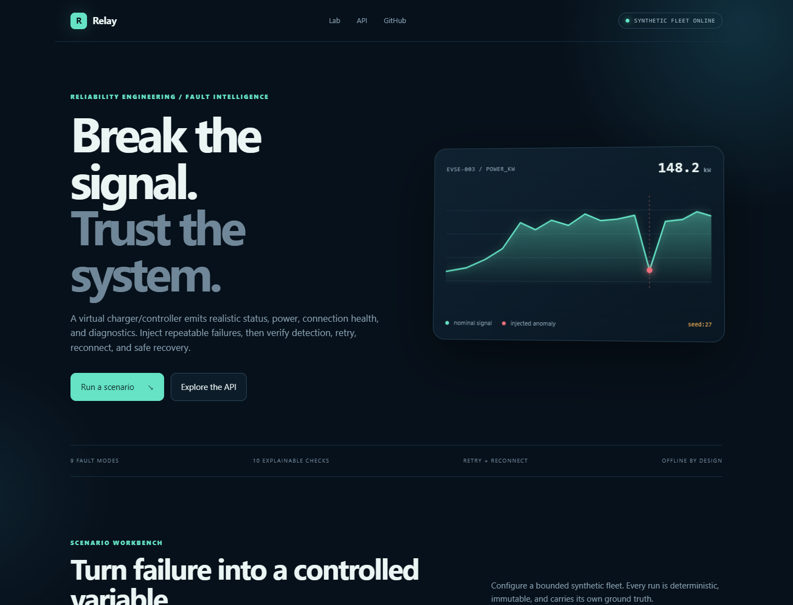
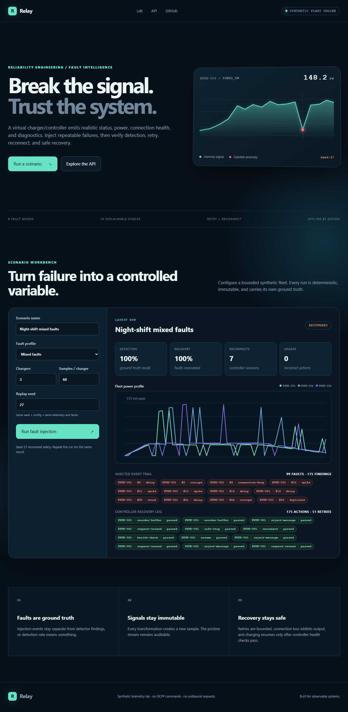
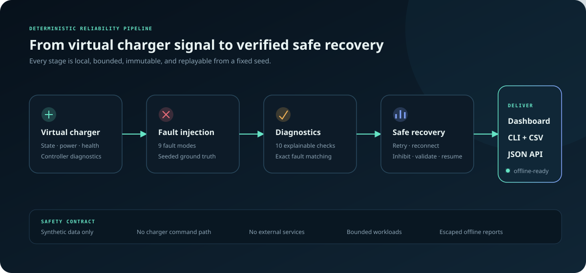

<div align="center">

# EV Charging Telemetry Fault Lab

**Simulate a charger/controller, inject network and message failures, then verify detection, diagnostics, retry, reconnect, and safe recovery.**

[](https://github.com/TarunT27/ev-charging-telemetry-fault-lab/actions/workflows/ci.yml)
[](https://www.python.org/)
[](#quality)
[](LICENSE)

</div>



## Why this exists

Fleet telemetry rarely fails cleanly. Packets arrive late, sensors freeze, values spike, timestamps regress, and duplicates hide inside otherwise healthy streams. Testing those conditions against production chargers is slow and risky.

This lab turns failure into a controlled variable. A virtual charger/controller publishes charging state, power, electrical measurements, connection health, and diagnostic codes. The Python harness injects faults with recorded ground truth, runs explainable checks, executes a bounded recovery policy, and verifies that invalid data never drives unsafe behavior. A fixed configuration and seed always produce the same run, making every failure reproducible locally and in CI.

> [!IMPORTANT]
> This is a **synthetic diagnostics lab**. It contains no OCPP command path, charger-control logic, customer telemetry, credentials, or outbound service dependency.

## What ships

| Capability | What it does |
| --- | --- |
| Virtual charger/controller | Produces immutable charging state, power, voltage, current, temperature, SOC, connection health, and diagnostic messages for up to 20 chargers |
| Nine fault modes | Injects timeouts, delays, connection drops, corrupt/incomplete messages, spikes, frozen sensors, duplicates, and out-of-order timestamps |
| Auditable ground truth | Records every injected event independently from detector output |
| Explainable diagnostics | Uses exact fault-to-rule matching across ten range, timing, message, connection, and electrical checks |
| Safe recovery verifier | Proves bounded retry, reconnect, safe-stop, reject/resend, deduplication, and validated resume behavior |
| Reliability metrics | Calculates detection/recovery rates, retries, reconnects, unsafe actions, rejects, drops, delay, power, and energy |
| Three delivery surfaces | Interactive web dashboard, versioned JSON API, and CLI exports to JSON/CSV/offline HTML |
| Production-minded boundaries | Strict validation, bounded workloads, hashed runtime lock, security headers, non-root container, and no remote assets |

## 60-second quick start

```bash
git clone https://github.com/TarunT27/ev-charging-telemetry-fault-lab.git
cd ev-charging-telemetry-fault-lab
python -m pip install -e .

# Generate JSON, CSV, and a self-contained HTML report in ./artifacts
python -m telemetry_lab demo
```

Launch the interactive dashboard:

```bash
python -m telemetry_lab serve
# open http://127.0.0.1:8000
```

The same commands are available through the installed `ev-fault-lab` entry point.



## Architecture



The core is a functional pipeline: the virtual charger emits pristine status messages, a seeded injector returns new observed messages plus fault events, diagnostics produce findings, and a virtual controller applies the recovery policy from those findings—not from injection labels. Retry/reconnect replies must pass telemetry and connection invariants before entering the recovered controller stream. An independent safety evaluator rejects early resume and invalid accepted state. Metrics compare exact detector rules with ground truth and report only recoveries that actually completed. The API, CLI, dashboard, and report renderer all call the same application service.

```text
ScenarioConfig
    -> virtual charger/controller
    -> immutable pristine samples
    -> seeded fault injector + ground-truth events
    -> explainable diagnostics
    -> bounded retry / reconnect / safe recovery
    -> detection + recovery metrics and action logs
    -> dashboard / JSON / CSV / offline HTML
```

## Fault catalog

| Fault | Signal change | Expected detector evidence |
| --- | --- | --- |
| `timeout` | Drops the sample | Ground-truth transport loss |
| `delay` | Moves observation time forward | P95 injected delay and possible ordering violation |
| `corrupt` | Writes an impossible negative power value | Measurement-range violation |
| `spike` | Multiplies power beyond the charging curve | Power-jump and electrical-consistency findings |
| `stuck` | Reuses the prior sensor fields | Sensor-freeze finding after repeated values |
| `duplicate` | Emits the same sequence twice | Duplicate-packet finding |
| `out-of-order` | Moves a timestamp backward | Timestamp-order finding |
| `connection-drop` | Reports the controller link offline and inhibits output | Connection-health finding + safe-stop/reconnect/resume log |
| `incomplete-message` | Removes a required diagnostic field | Message-completeness finding + reject/resend log |

Fault probabilities are combined into curated presets. The injector chooses at most one configured fault per pristine sample, so totals stay interpretable and replayable.

## CLI

Run a custom bounded scenario:

```bash
python -m telemetry_lab run \
  --preset noisy-network \
  --name "Uplink degradation drill" \
  --seed 402 \
  --chargers 6 \
  --samples 180 \
  --output-dir artifacts/uplink
```

Discover available profiles:

```bash
python -m telemetry_lab list-presets
python -m telemetry_lab --help
```

Each completed run writes:

- `*.json` — configuration, metrics, fault events, findings, controller recovery actions, and observed samples
- `*.csv` — observed telemetry including charging state, connection health, and diagnostic code
- `*.html` — portable, responsive report with inline CSS and SVG; no CDN or network access

Writes are atomic, scenario names are sanitized for filenames, and report content is HTML-escaped.

## API

Run the server, then open the self-hosted API reference at [`/api/docs`](http://127.0.0.1:8000/api/docs) or consume the machine-readable schema at `/openapi.json`.

```bash
curl -X POST http://127.0.0.1:8000/api/v1/scenarios \
  -H "Content-Type: application/json" \
  -d '{
    "name": "Night shift drill",
    "preset": "mixed-faults",
    "seed": 27,
    "charger_count": 3,
    "samples_per_charger": 60
  }'
```

Endpoints:

| Method | Path | Purpose |
| --- | --- | --- |
| `GET` | `/health` | Lightweight liveness check |
| `GET` | `/api/v1/presets` | Curated fault-profile catalog |
| `POST` | `/api/v1/scenarios` | Validate and synchronously run a bounded scenario |
| `GET` | `/api/docs` | Self-hosted API reference with no remote assets |

Responses use a consistent `{ success, data, error }` envelope. Inputs reject unknown fields and are bounded to a 32 KiB body and 20 chargers × 1,000 samples. Scenario calls are limited to 12/client/minute and two concurrent runs; response collections are capped at 500 representative records while totals remain in `meta`. The server sets CSP, clickjacking, content-sniffing, referrer, permissions, and request-ID headers.

## Docker

```bash
docker build -t ev-fault-lab .
docker run --rm -p 127.0.0.1:8000:8000 ev-fault-lab
```

The image runs as an unprivileged user, exposes a health check, and serves only local package assets. Open [http://127.0.0.1:8000](http://127.0.0.1:8000).

## Quality

The project follows test-driven development across pure domain logic, integration boundaries, API contracts, report security, and subprocess CLI flows.

```bash
python -m pip install -e ".[dev]"
ruff check .
mypy telemetry_lab
pytest --cov=telemetry_lab --cov-branch --cov-report=term-missing
pip-audit
```

Current verification includes unit, integration, API-security, offline-report, recovery-policy, and subprocess CLI tests with an enforced **80%+ branch-aware coverage** gate. CI repeats linting, strict typing, dependency audit, coverage, CLI smoke tests, and a Docker health-check smoke test on Python 3.11 and 3.13.

## Project map

```text
telemetry_lab/
├── models.py       # frozen domain contracts and serialization
├── generator.py    # realistic seeded charging curves
├── faults.py       # pure fault injectors + ground truth
├── diagnostics.py  # explainable rules and reliability metrics
├── recovery.py     # virtual controller retry/reconnect/safe recovery
├── service.py      # shared scenario orchestration
├── report.py       # self-contained offline analytics report
├── exporters.py    # atomic JSON, CSV, and HTML output
├── api.py           # validated FastAPI delivery layer
├── cli.py           # demo, run, preset, and serve commands
└── static/          # responsive no-build dashboard
tests/               # unit, integration, security, and CLI E2E tests
scenarios/           # readable example scenario contracts
assets/              # real dashboard screenshot and architecture visual
```

## Design decisions and limits

- **Synchronous, bounded runs:** ideal for a reproducible lab. A production fleet control plane would move long runs to a queue.
- **No database:** every scenario is derived from configuration and seed, while exports provide durable artifacts. Persistence can be added behind the service boundary later.
- **Rule-based diagnostics:** each fault has an explicit expected rule, so “detection rate” is true ground-truth recall rather than unrelated co-located findings.
- **Deterministic recovery policy:** diagnostics—not injection labels—drive bounded retries, reconnects, and fail-closed resume checks; an independent invariant evaluator verifies action ordering and recovered telemetry state. No live charger commands are sent.
- **Synthetic charging curves:** suitable for engineering exercises and CI—not certification, energy billing, or hardware validation.
- **Single-process metrics:** this version measures each scenario directly rather than exposing a multi-instance observability backend.

## Contributing

See [CONTRIBUTING.md](CONTRIBUTING.md). New faults must be immutable, deterministic, ground-truth recorded, and introduced with a failing test.

## License

[MIT](LICENSE) © 2026 Tarun T
